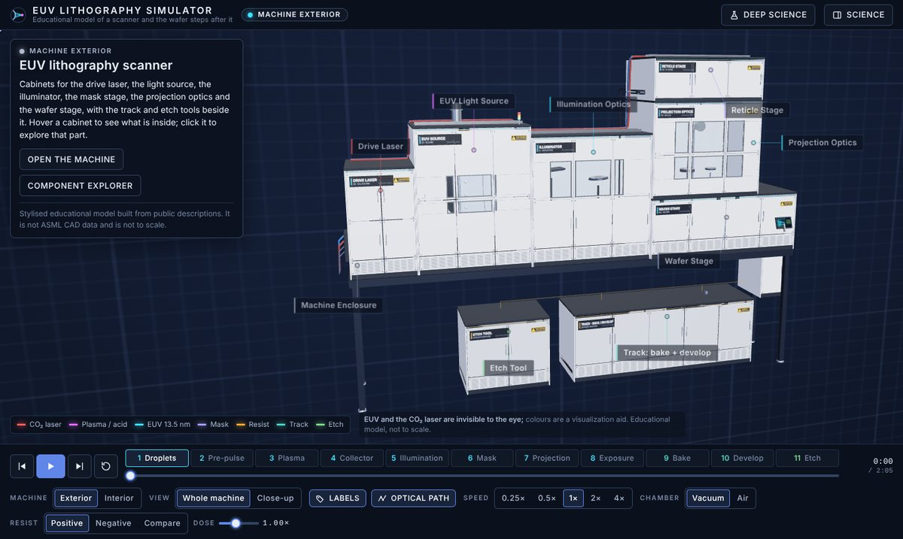
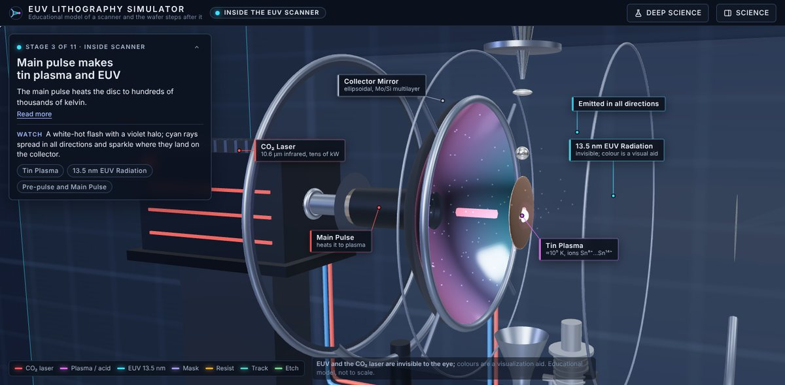
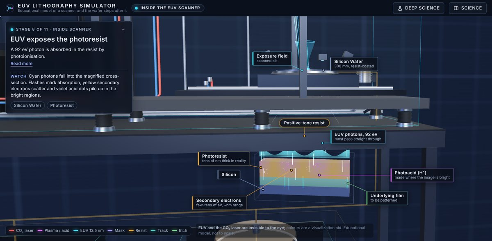
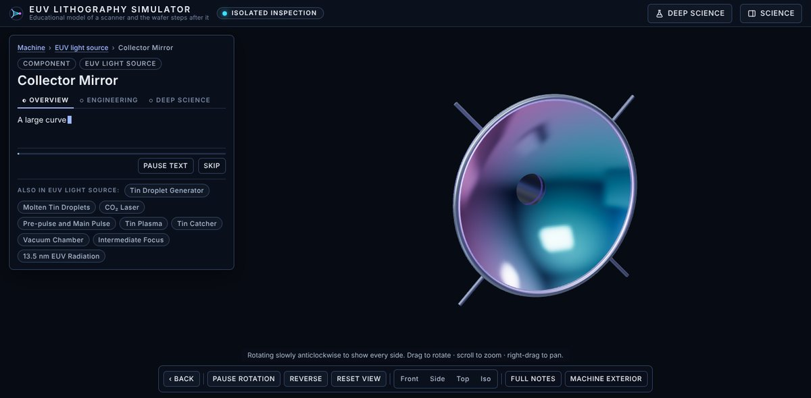
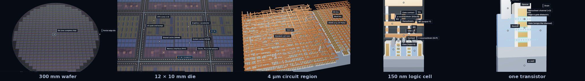
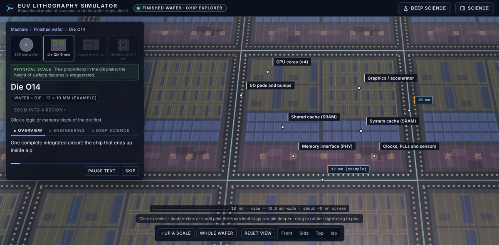
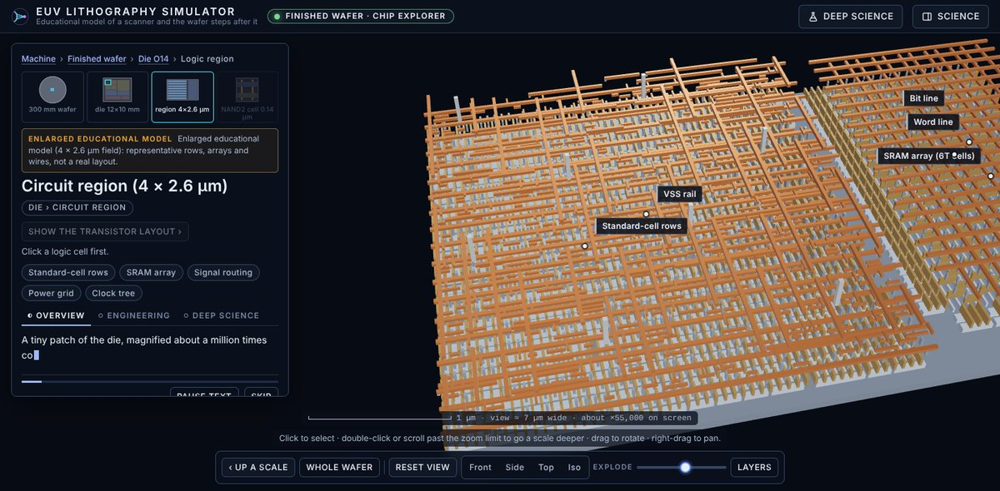
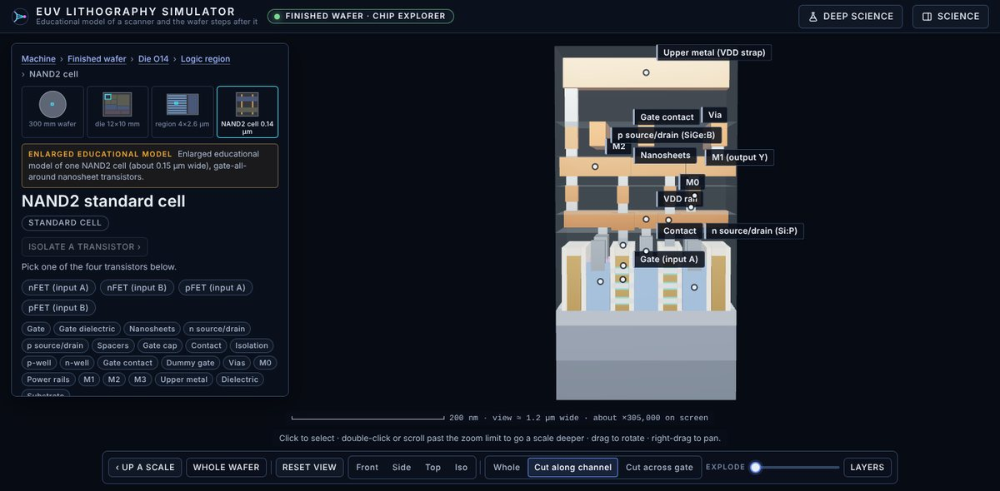
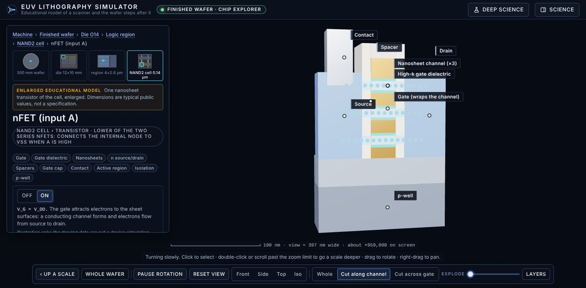

<div align="center">

# EUV Lithography Simulator

### From a tin droplet to a 14 nm transistor gate: an interactive 3-D tour of how the most advanced chips are printed



**[⬇ Download and run (one HTML file)](euv-simulator/download/EUV-Lithography-Simulator.html)** ·
[What's inside](#whats-inside) ·
[Controls](#controls) ·
[Run from source](#run-from-source) ·
[How it's built](#how-its-built) ·
[Full technical notes](euv-simulator/README.md)


</div>

---

A modern chip is printed with light of **13.5 nanometres**, made by hitting molten tin droplets with a laser
**50,000 times a second**, bounced off mirrors polished to atomic smoothness, and focused onto a silicon wafer.
This project lets you walk through that whole machine, take it apart piece by piece, run the process stage by
stage, and then zoom into the finished wafer all the way down to a single transistor.

It is an **educational model**: geometry and numbers are simplified, rounded public values, not ASML designs or
CAD data. EUV light is invisible; the colours are a visualisation aid.

## Try it in 10 seconds

1. Open **[`euv-simulator/download/EUV-Lithography-Simulator.html`](euv-simulator/download/EUV-Lithography-Simulator.html)**
   and click **Download raw file**.
2. Double-click the downloaded file. It opens in Chrome, Edge, Firefox or Safari: no server, no account,
   no installation, and it works offline.

## What's inside

### 1 · The machine, outside and in

The simulator opens on the closed scanner: cabinets for the drive laser, the light source, the illuminator, the
mask stage, the projection optics and the wafer stage, with the separate track and etch tools beside it. Press
**Open the machine** and the panels slide away to reveal the light source, the mirror optics, the stages and the
support systems (metrology frame, vacuum pumps, cooling, cabling).



### 2 · The process, in 11 stages

One timeline (about two minutes at 1×) that you can play, pause, scrub or step through:

| | Inside the EUV scanner | | After the scanner (separate tools) |
|---|---|---|---|
| 1 | Tin droplets enter the source | 9 | Post-exposure bake amplifies the image |
| 2 | A laser pre-pulse flattens each droplet | 10 | Development dissolves the soluble resist |
| 3 | The main pulse makes tin plasma and EUV light | 11 | Etching transfers the pattern into the wafer |
| 4 | The collector mirror focuses the light | | |
| 5 | Illumination optics shape the beam | | |
| 6 | The reflective mask carries the circuit pattern | | |
| 7 | Six mirrors shrink the image 4× | | |
| 8 | EUV photons expose the photoresist | | |

Change the **resist tone** (positive, negative, or both side by side), the **exposure dose**, or fill the
chamber with **air** to see why EUV only works in vacuum.



### 3 · Take any part apart

Click any of the 27 parts or 7 subsystems and everything else disappears. The part is centred and turns slowly,
and its explanation types itself out in three levels: **Overview → Engineering → Deep science**. Drag to rotate,
scroll to zoom, jump to Front / Side / Top / Iso views, and press **Back** to return exactly where you were.



### 4 · Zoom from the wafer to a single transistor

At the end of the process, press **Inspect finished wafer** and keep zooming: through the 300 mm wafer, into one
die, into a 4-micrometre patch of circuitry, into a logic cell, down to one gate-all-around nanosheet transistor.



| Scale | What you see | What you can do |
|---|---|---|
| **Wafer** · 300 mm | 504 complete example dies, partial dies at the edge, the notch | select any die |
| **Die** · 12 × 10 mm | a system-on-chip floorplan: CPU cores, SRAM caches, graphics, memory interface, I/O bumps | select a block, see its size |
| **Circuit region** · 4 × 2.6 µm | rows of logic cells, an SRAM array, signal wiring, a clock tree, the power grid | isolate each structure |
| **Cell** · ≈150 nm | a NAND2 gate made of four nanosheet transistors, with contacts, vias and four metal levels | click any of 22 kinds of part |
| **Transistor** · 14 nm gate | one transistor, enlarged and turning | cut along the channel or across the gate, explode the layers, switch it ON |

The first two scales are true to proportion; from the circuit region on, the view is an **enlarged educational
model**, and a badge and a live scale bar ("view ≈ 1.2 µm wide, about ×300,000 on screen") always say which one
you are looking at.

<table>
<tr>
<td width="50%"></td>
<td width="50%"></td>
</tr>
<tr>
<td></td>
<td></td>
</tr>
</table>

### And more

- **Science panel** with an inspector for every part (physics, chemistry, equations, and what is real versus simplified), 12 concepts at three levels, and a 15-question quiz.
- **Deep Science** mode adds advanced notes and the limits of the model everywhere.
- Small interactive labs: photon energy, diffraction and resolution, resist response, multilayer mirrors, mask patterns, Beer–Lambert absorption, and a chart that follows one line pattern from mask to etch.
- Works on phones: a bottom-sheet panel and touch controls.

## Controls

| Mouse / touch | |
|---|---|
| Drag | rotate |
| Scroll / pinch | zoom |
| Right-drag / two-finger drag | pan |
| Click / tap | select or inspect |
| Double-click, or scroll past the zoom limit | go one scale deeper (wafer explorer) |

| Key | |
|---|---|
| `Space` | play / pause |
| `←` `→` | previous / next stage |
| `O` | open / close the machine |
| `L` · `P` | labels · optical path |
| `M` | whole machine / close-up |
| `D` | Deep Science |
| `R` | restart |
| `Esc` | back one step |

## Run from source

```bash
cd euv-simulator
npm install
npm run dev               # http://localhost:5173
npm run build             # type-check + production build + single-file build in dist/
npm run test:e2e          # 56 end-to-end tests (Playwright, headless Chromium)
npm run test:standalone   # the single-file builds start and draw the scene
```

## How it's built

- **React 19 + plain Three.js + TypeScript + Vite.** One small store drives everything: the timeline, the 3-D scene, the cards and the panels.
- **The scene is a pure function of time.** Every droplet, pulse and photon is computed from the clock, so scrubbing, jumping and replaying always show the same picture.
- **Optics from real geometry.** The collector is an ellipsoid with the plasma at one focus, and every mirror's orientation is computed from the law of reflection for the drawn beam path.
- **One resist model** drives both the 3-D cross-section and the charts: aerial image → acid → bake → development → etch.
- **Isolation uses render layers**, not copies, so taking a part out of the machine costs nothing.
- **The chip explorer is built from instanced boxes:** about 4,800 of them in 6 draw calls for the whole circuit region. Because every part is a box, cross-sections are exact, and exploding, hiding and highlighting layers are cheap per-instance updates.
- **Tested like an app:** 56 end-to-end tests use real mouse, keyboard, wheel and touch input and check real state and rendered pixels.

More detail, including what the tests do and do not cover, is in **[euv-simulator/README.md](euv-simulator/README.md)**.

## Honest about the science

| Established science, shown | Simplified or illustrative |
|---|---|
| Tin plasma emitting 13.5 nm light, collected by a multilayer mirror | Positions, mirror counts and beam shapes are approximations |
| EUV absorbed by air, hence vacuum | How quickly EUV fades in air is exaggerated so you can see it |
| Reflective masks, 4× reduction, numerical aperture 0.33 | No proprietary optical design is used |
| Chemically amplified resist: photons → electrons → acid → bake → develop | The resist chemistry is named step by step, not written as an invented reaction |
| Wafer → die → cells → transistors → metal stack | The die, floorplan, layout and all dimensions are examples, not a real chip |
| Gate-all-around nanosheet transistor structure | The ON/OFF animation is an illustration, not a device simulation |

Not affiliated with or endorsed by ASML. All numbers are rounded public values, labelled as examples where they are.

## Repository

```
euv-simulator/
├── download/   EUV-Lithography-Simulator.html: the whole app in one file
├── docs/       screenshots used in this README
├── src/
│   ├── data/   stages, components, concepts, quiz, labels, chip-explorer content
│   ├── scene/  Three.js scene: machine, casing, optics, wafer, resist, chip explorer
│   ├── store/  the simulation store
│   └── ui/     React interface
└── tests/      end-to-end tests
```

`main` holds the latest version. Development happens on `claude/euv-lithography-simulator`, and
`backup/working-asml-simulation` is a protected snapshot of the first version.
