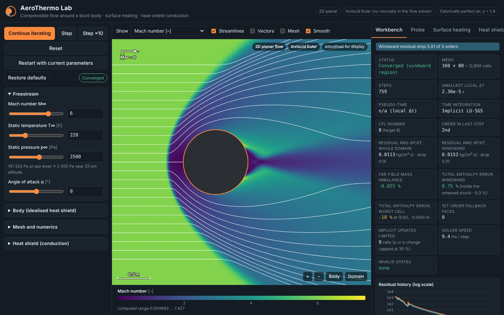
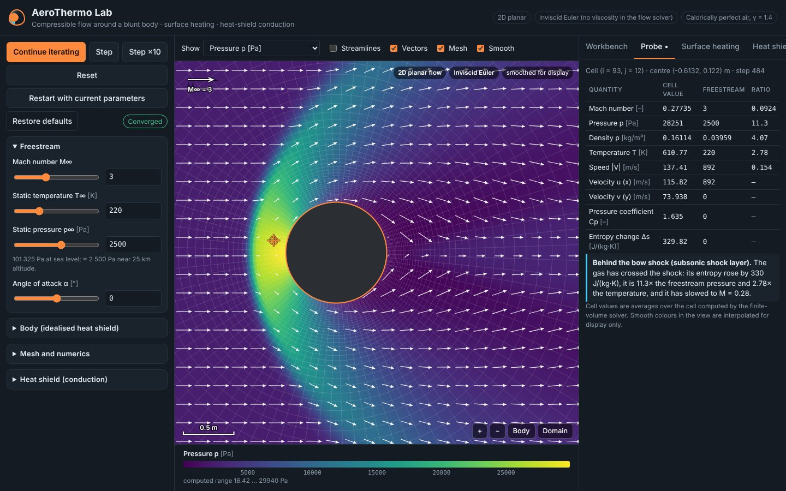
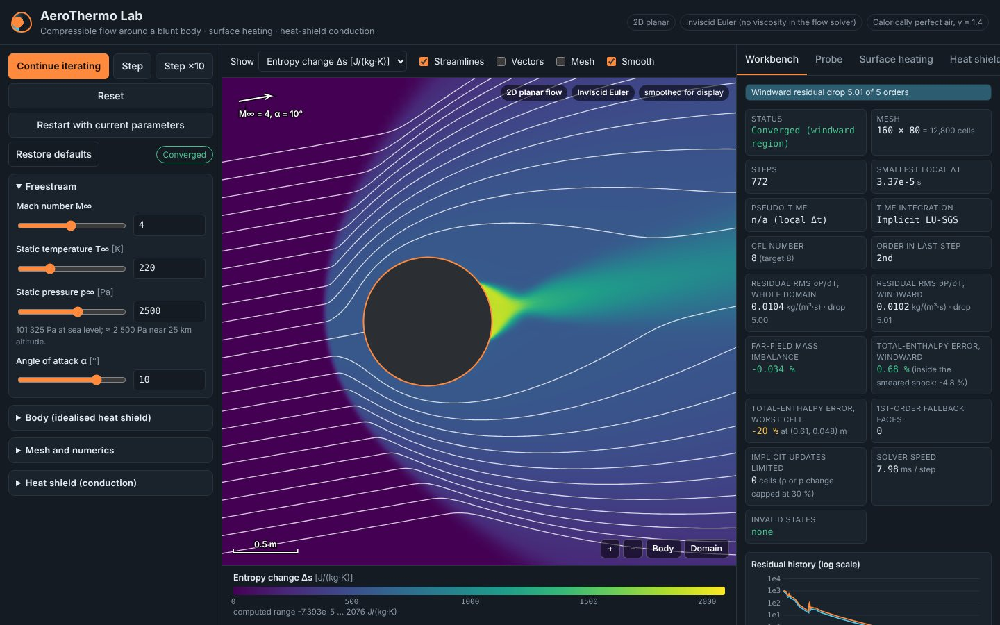
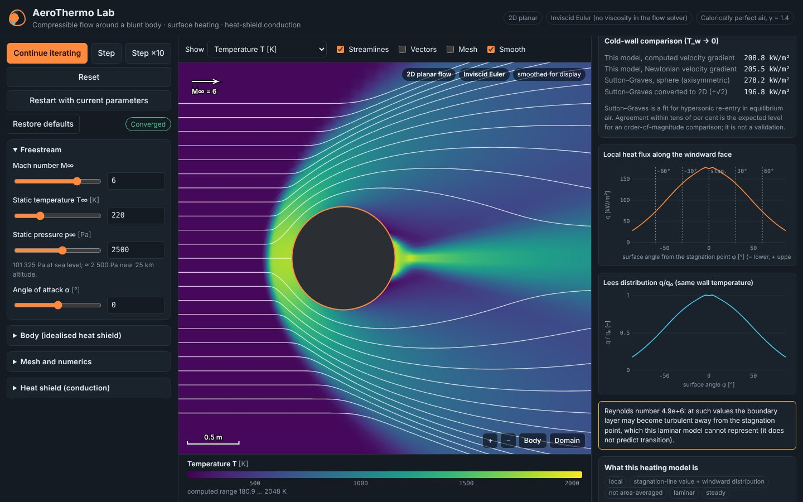
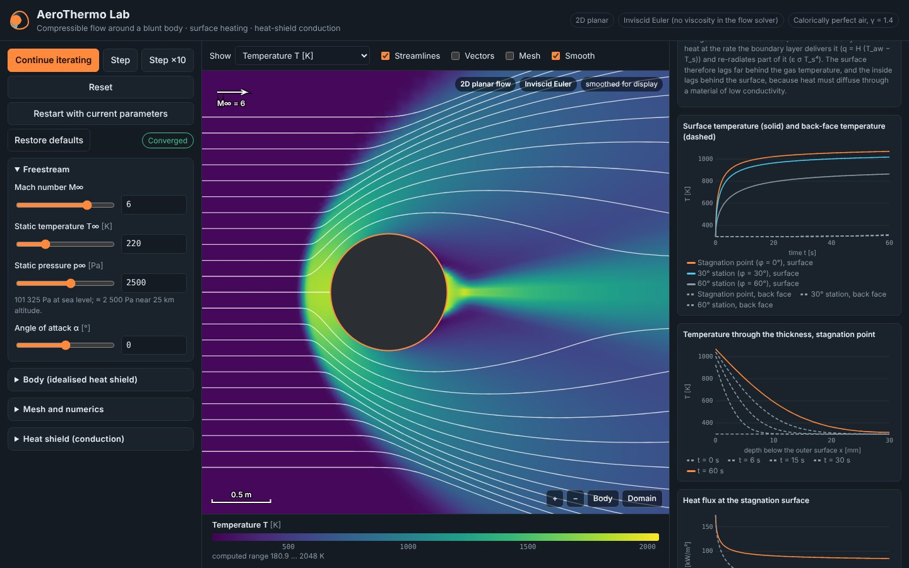
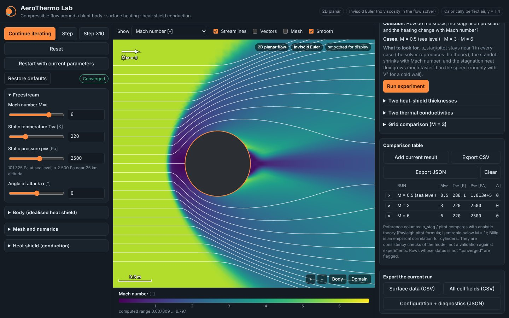

<div align="center">

# AeroThermo Lab

### An interactive compressible-flow and heat-shield simulator that runs a real finite-volume solver in your browser



</div>

Air flows past a blunt body, the cross-section of an idealised heat shield. AeroThermo Lab solves the 2D
compressible Euler equations on a body-fitted mesh and estimates the surface heating with a boundary-layer
correlation fed by the computed flow. It then computes how heat soaks into the shield. Every number on screen
comes from a calculation, and the app says what each number is, where it comes from and how far it can be
trusted.

**It is a teaching and exploration tool, not a design code.** The flow solver is inviscid (no viscosity, no
turbulence), the gas is calorically perfect air, and the heat shield does not ablate. See [Limits](#limits).

## Run it

```bash
cd aerothermo-simulator
npm install
npm run dev          # http://localhost:5173
npm test             # 82 unit and verification tests (Vitest)
npm run build        # type-check + production build into dist/
npm run test:e2e     # 17 end-to-end tests of the build in headless Chromium (needs Playwright)
```

## What it computes

| Part | Model | Where |
|---|---|---|
| Gas | Calorically perfect air: R = 287.05 J/(kg·K), γ = 1.4, c_p = 1004.7 J/(kg·K); Sutherland viscosity (for heating only) | `src/core/gas.ts` |
| Mesh | Body-fitted O-grid around a circle or ellipse, geometric wall-normal stretching, far field 8–25 half-heights away | `src/core/mesh.ts` |
| Flow | 2D Euler equations, conservative finite volumes, Rusanov flux, MUSCL (minmod / van Albada), SSP-RK2 or implicit LU-SGS | `src/core/euler.ts` |
| Boundaries | Slip wall (mirror state after reconstruction), characteristic far field (Riemann invariants), periodic seam | `src/core/euler.ts` |
| Heating | Laminar stagnation-line correlation for a 2D cylinder with solver edge conditions; Lees distribution on the windward face | `src/core/heating.ts` |
| Conduction | 1D transient conduction through the thickness, implicit, energy-conserving; convective heating minus re-radiation | `src/core/thermal.ts` |

### Flow solver

- **Finite-volume form:** each cell stores mass, momentum and energy, and fluxes through faces are exchanged between neighbours, so conservation holds to round-off.
- **Shock capturing:** the Rusanov flux is used, and second-order reconstruction falls back to first order on any face where it would give non-positive density or pressure. Those faces are counted and shown.
- **Time marching:**
  - *time-accurate*: one global CFL time step, so every snapshot is a physical moment;
  - *steady state*: local time steps. Supersonic steady runs use a matrix-free implicit LU-SGS step (Yoon & Jameson) at CFL ≈ 8; subsonic runs keep the explicit scheme, which preserves the flow's symmetry exactly.
- **Convergence:** judged on the RMS of ∂ρ/∂t falling by a set number of orders of magnitude, measured over the whole domain or, for supersonic flow, the windward region (which the wake cannot influence).
  - A residual that stops falling is reported as *levelled off*, never as converged.
- **Invalid states:** density and pressure are checked after every stage. A non-physical state stops the solver, restores the last valid state and reports the cell, stage and values. Nothing is clipped.

### Surface heating

The inviscid solver cannot compute heat flux, so heating is estimated with laminar boundary-layer theory. The
solver's wall values serve as the boundary-layer edge conditions.

- **Stagnation line, 2D cylinder.** The formula is from Anderson, *Hypersonic and High-Temperature Gas Dynamics*, 2nd ed., §6.6, based on the Fay–Riddell / Cohen–Reshotko similarity solutions:

  q₀ = 0.57 Pr^−0.6 √(ρₑμₑ · duₑ/ds) · (h_aw − h_w),  with Pr = 0.71.

  The velocity gradient duₑ/ds is fitted to the computed wall velocities. The Newtonian estimate is shown as a cross-check.
- **Windward face.** Heating follows Lees' local-similarity distribution. It is marked *not applicable* beyond the shoulders.
- **Comparison.** Sutton–Graves (NASA TR R-376) is given for a sphere and converted to 2D (÷√2). It is an order-of-magnitude comparison only.
- **Output.** The result is a heat-transfer coefficient and an adiabatic-wall temperature. It is a local value: stagnation line plus distribution, not area-averaged.

### Heat-shield conduction

The model solves ρ c_p ∂T/∂t = k ∂²T/∂x² through the thickness. At the surface, the heating from the boundary
layer is balanced against grey-body re-radiation ε σ T⁴; the back face is insulated or held at a fixed temperature.

- **Numerics:** backward Euler with Newton linearisation of the radiation term, and a Thomas tridiagonal solver.
- **Coupling:** quasi-steady, so the heating is held constant during the exposure. The app shows the flow time and conduction time that justify this.
- **Output:** results at the stagnation point, 30° and 60°, plus a map of independent 1D columns (no sideways conduction).

## Verification

Every check below is an automated test with its tolerance and measured values recorded in the test file. The
references are analytic solutions unless marked *correlation*. Agreement with a correlation is a consistency check,
not a validation against experiment.

| Check | Reference | Result |
|---|---|---|
| Uniform flow on the curved O-grid stays uniform (incl. implicit step at CFL 20) | exact | deviation < 1e-11 |
| Mass and energy in a closed box and a curved annulus | exact conservation | < 1e-12 relative |
| Sod shock tube, L1 density error, 200 → 400 cells | exact Riemann solver (Toro) | 1st order 0.018 → 0.012; 2nd order 0.0053 → 0.0030; plateau p*, u* within 0.1 % |
| Stagnation pressure, M = 3 (coarse / medium / fine) | Rayleigh pitot formula | 0.993 / 0.995 / 0.996 |
| Stagnation pressure, M = 6 (coarse) | Rayleigh pitot formula | 0.987 |
| Stagnation temperature, M = 3 / 6 | T₀ = T(1 + 0.2 M²) | +0.8 % / +1.0 % |
| Subsonic stagnation pressure, M = 0.5 (coarse / medium) | isentropic p₀ | +1.15 % / +0.73 % (Rusanov low-Mach error, falls with refinement) |
| Bow-shock standoff, M = 3 (coarse / medium) and M = 6 | Billig, *correlation* | 0.716 / 0.710 vs 0.649; 0.458 vs 0.439 |
| Total enthalpy, windward side outside the smeared shock | exact (constant) | 0.96 % |
| Implicit and explicit steady states | each other | stagnation pressure within 0.1 %, standoff within 0.5 % |
| Stagnation velocity gradient, M = 3 / 6 | Newtonian theory (approximate) | within 1.2 % / 3.4 % |
| Cold-wall stagnation heating, M = 3 / 6 | Sutton–Graves 2D, *correlation* | 33.5 vs 24.6 kW/m² / 209 vs 197 kW/m² |
| Lees distribution, manufactured edge conditions | independent integration | within 1 % |
| Conduction, semi-infinite solid under constant flux | analytic (Carslaw & Jaeger) | 7.2e-5 of the temperature rise; 1st order in time, 2nd in space |
| Conduction, fixed back face, steady state | exact linear profile | < 1e-6 K |
| Conduction energy balance | exact | 1e-13 relative |

The end-to-end tests cover:

- Run, Pause, Resume, Step, Reset, Restart and Restore defaults.
- The restart-needed banner; stale results from a superseded run are never shown.
- Probe readings against the solver's own cell values, and the legend and overlays.
- Heating, the heat shield, an experiment with CSV/JSON export, a predict-run-compare activity, and failure handling.
- The phone layout, with no console errors throughout.

## Performance

Measured in headless Chromium with the solver in a Web Worker (`node tests/e2e/perf.mjs`), in the cloud container
the project was developed in. Absolute times depend on the machine.

| Case | Mesh | Scheme | Steps | Time | Result |
|---|---|---|---|---|---|
| M = 3 | 96 × 48 | implicit | 484 | 1.8 s | converged (5 orders) |
| M = 3 | 160 × 80 | implicit | 774 | 8 s | converged |
| M = 3 | 240 × 120 | implicit | 1 141 | 27 s | converged |
| M = 0.5 | 96 × 48 | explicit | 2 921 | 11 s | converged |
| M = 0.5 | 160 × 80 | explicit | 7 141 | 74 s | levelled off at 4.6 orders |

Before the implicit solver, the explicit scheme had not converged on the medium mesh after 12 000 steps. The slow
mode was the near-stagnant flow around the stagnation point.

## The interface

<table>
<tr>
<td width="50%"></td>
<td width="50%"></td>
</tr>
<tr>
<td></td>
<td></td>
</tr>
</table>

- **View:**
  - any of nine computed fields: Mach, p, ρ, T, |V|, u, v, Cp and entropy change;
  - cell values or smoothed display;
  - overlays: mesh, velocity vectors, streamlines integrated through the computed velocity;
  - legend with units, scale bar, pan / zoom / pinch.
- **Run controls:** Run, Pause, Resume, Step, Step ×10, Reset, Restart with current parameters and Restore defaults. A banner appears whenever the controls no longer match the results on screen.
- **Workbench:**
  - status, steps, Δt, CFL and scheme;
  - both residuals and their history;
  - far-field mass imbalance and total-enthalpy errors;
  - fallback faces, limited implicit updates and invalid states;
  - basic and deep explanations of each number.
- **Probe:** reads the computed cell under the cursor, compares it with the freestream, and interprets the reading (freestream, shock layer, stagnation region, expansion…) from the values themselves.
- **Surface heating and heat shield:** the models above, with their assumptions, sources and range shown in the tab.
- **Experiments:**
  - scenarios: subsonic, supersonic, M = 6, incidence, blunt face;
  - automated experiments: Mach number, two thicknesses, two conductivities, grid comparison;
  - a comparison table, exported as CSV/JSON, plus exports of surface data, all cell fields and run diagnostics.
- **Learn:** eight topics at three levels (intuitive, engineering, numerical), three predict-run-compare activities evaluated from computed results, and a probe activity.



## Limits

- **Inviscid flow:** no boundary layer, separation or turbulence in the flow solver. The wake behind the body is unrealistic: the flow expands almost to vacuum, with total-enthalpy errors up to ~20 % there. Treat it as qualitative.
- **Planar 2D:** the body is a cross-section of an infinitely long cylinder, not a capsule. Axisymmetric stagnation heating would be about √2 higher.
- **Calorically perfect gas:** above ~2 000 K real air dissociates; the app warns when T₀ exceeds this.
- **Heating:** a laminar continuum correlation with an uncertainty of order 10–20 %, evaluated with first-cell wall values. It does not predict transition and flags high Reynolds and Knudsen numbers.
- **Heat shield:** constant properties, no ablation or pyrolysis, quasi-steady heating, independent 1D columns. The insulating material presets are illustrative values, not data for a product; the metals use Incropera Table A.1 at 300 K.
- **Numerical accuracy:** the Rusanov flux is robust but diffusive. Shocks are smeared over 2–3 cells, and subsonic stagnation pressure is about 1 % high on the coarse mesh.

## Code layout

```
aerothermo-simulator/
├── src/
│   ├── core/       physics and numerics, no UI: gas, mesh, euler (solver), riemann (exact), config,
│   │               simulation (runner + diagnostics), heating, thermal, materials, experiments, interpret
│   ├── worker/     flow.worker.ts runs the solver off the main thread; protocol.ts tags every message with a run id
│   ├── viz/        WebGL field renderer (Canvas 2D fallback), overlays, colour maps, camera, point location
│   └── ui/         React: store (edited vs computed configuration), controls, panels, plots, teaching text
├── tests/          Vitest unit and verification tests; e2e/ end-to-end, performance and screenshot scripts
└── docs/images/    screenshots used here
```

The UI keeps two configurations apart: the one the controls show and the one the displayed results were computed
with. Results are never relabelled as belonging to edited parameters. Messages from a superseded run are
discarded by run id.
